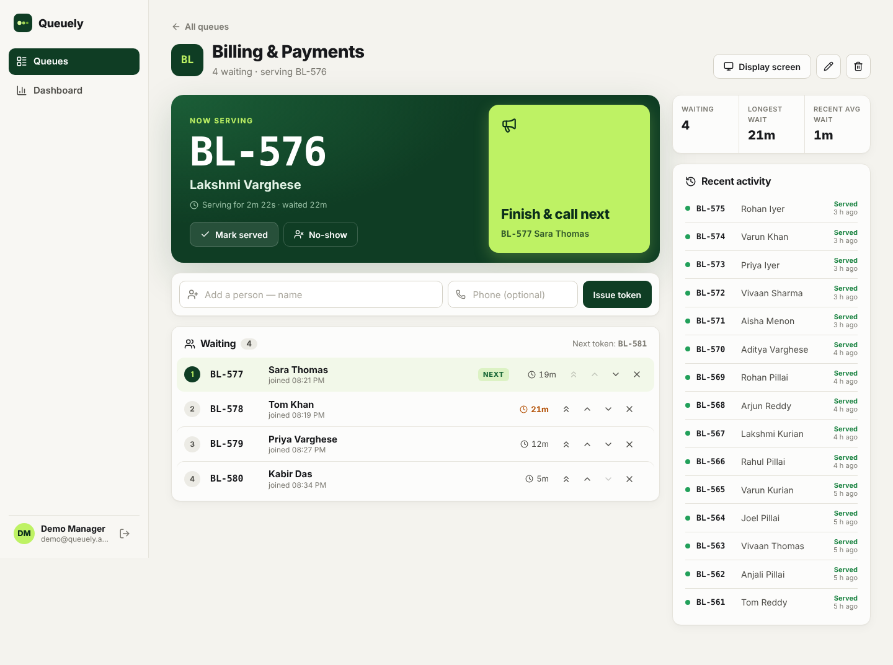
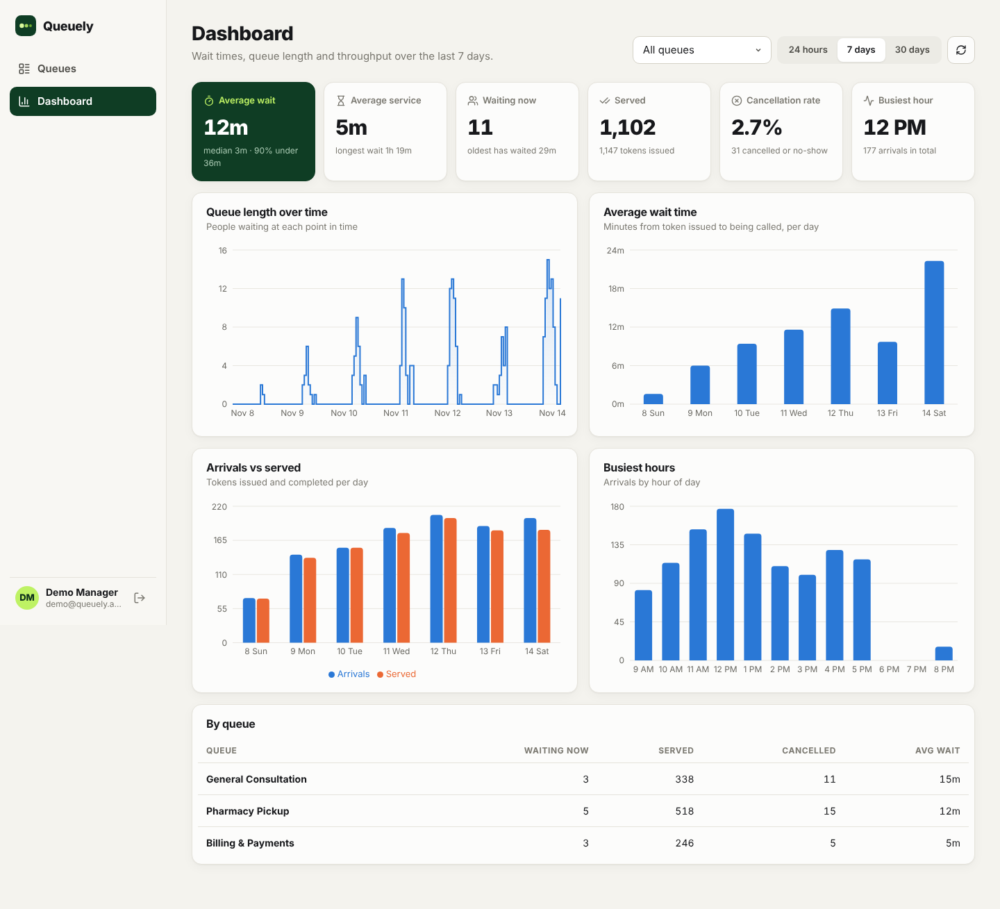

# Queuely: Queue Management System

A full-stack queue management app. A manager signs in, creates queues, issues tokens to people, reorders the line, calls the next person with one click, cancels tokens and tracks wait times on an analytics dashboard.




**Stack:** React 19 + Vite + React Router + Recharts · Node.js + Express · SQLite (better-sqlite3) · JWT auth with bcrypt-hashed passwords · `node:test` + Supertest

---

## Features

| Requirement | How it works |
|---|---|
| 1. Manager login & create queues | Register or sign in (JWT, 7-day session). Each manager only sees their own queues. |
| 2. Each queue has a name | Required name (plus an optional 1–3 letter token prefix, e.g. `GC`). You can rename or delete a queue. |
| 3. Add people → token created | Enter a name (phone optional) to issue a sequential token like `GC-042`. |
| 4. Waiting list | Shows position, token, name, join time and a live "time waiting" counter. Waits over 20 min are highlighted. |
| 5. Move tokens up/down | ▲ / ▼ buttons, plus **move to top**. Swaps run in a database transaction. |
| 6. Assign top token for service | One big **Call next** button. It finishes the current person and calls the top token. You can also **Mark served** without calling the next person. |
| 7. Cancel a token | Cancel any waiting token, or mark the person being served as a **no-show**. Both ask for confirmation first. |
| 8. Analytics dashboard | Average / median / 90th-percentile wait, average service time, queue length over time, wait-time trend, arrivals vs served, busiest hours, cancellation rate and a per-queue breakdown. You can filter by queue and by 24 h / 7 d / 30 d. |

**Extras**
- **Public display screen** (`/display/:key`) for a TV in the waiting area. It shows the token now being served and who is up next (first names only), and it flashes when a new token is called. The link uses an unguessable key, so queue IDs aren't exposed.
- Live updates: the queue page polls every 5 s. Out-of-order responses are discarded, so the screen never jumps back to stale data.
- Responsive layout down to phone width, keyboard-friendly forms, toasts, empty states and confirmation dialogs.
- A demo account seeded with about 2,500 realistic tokens over two weeks, so the dashboard has data from the start.

---

## Quick start

Requires **Node.js 18+**.

```bash
npm run setup     # install server + client dependencies
npm run seed      # optional: demo account with 2 weeks of history
npm run build     # build the React app
npm start         # http://localhost:4000  (API + UI on one port)
```

Demo login: **demo@queuely.app / demo1234** (or click *Explore with the demo account*).

### Development (hot reload)

```bash
npm run dev:server   # API on :4000 (restarts on change)
npm run dev:client   # UI on :5173 (proxies /api to :4000)
```

### Tests

```bash
npm test
```

There are 20 API tests. They cover auth, validation, keeping each manager's data private, token numbering, reordering (including edge cases), serve-next order after moves and cancels, double cancels, the public display and the analytics maths.

### Configuration

| Env var | Default | |
|---|---|---|
| `PORT` | `4000` | API/UI port |
| `JWT_SECRET` | dev value | **Set this in production** |
| `DB_FILE` | `server/data/queuely.db` | SQLite file path |

---

## Architecture

```
queuely/
├── server/
│   ├── src/
│   │   ├── index.js       # boots Express
│   │   ├── app.js         # routes, auth middleware, validation, error handling
│   │   ├── db.js          # SQLite schema
│   │   ├── analytics.js   # dashboard metrics
│   │   └── seed.js        # demo data generator
│   └── test/api.test.js
└── client/
    └── src/
        ├── lib/           # api client, auth context, polling hooks, formatters
        ├── components/    # layout, modal, toasts, confirm dialog
        └── pages/         # Auth, Queues, QueueDetail, Dashboard, Display
```

### Data model

```
managers (id, name, email UNIQUE, password_hash, created_at)
queues   (id, manager_id → managers, name, prefix, next_number, display_key UNIQUE, created_at)
tokens   (id, queue_id → queues, number, code, person_name, phone,
          status: waiting | serving | served | cancelled,
          position REAL, created_at, called_at, completed_at, cancelled_at)
```

- **Token lifecycle:** `waiting → serving → served`, or `waiting/serving → cancelled`. Every state change is timestamped, and all analytics come from these timestamps.
  - wait time = `called_at − created_at`
  - service time = `completed_at − called_at`
- **Ordering** uses a `position` column, not `created_at`. Moving up or down swaps positions with the neighbouring waiting token. Moving to the top sets `position = min − 1`. New tokens get `max + 1`, so they always join at the back even after reordering.
- **Token numbers** come from a per-queue `next_number` counter, so numbers are never reused after a cancellation.
- **Consistency:** issue, move and serve-next each run inside a SQLite transaction. Every write also checks the expected current status (`... WHERE status = 'waiting'`), so a stale UI can't double-serve or double-cancel a token. The API returns `409` in that case and the UI refreshes.

### Analytics

`GET /api/analytics?range=24h|7d|30d&queueId=all|<id>&tz=<offset>`

- **Wait and throughput charts** group events by the manager's local hour (24 h) or local day (7 d / 30 d). The browser sends its timezone offset, so a "day" means the manager's calendar day.
- **Queue length over time** is rebuilt from events. At each sample point it counts tokens where `created_at ≤ t` and the token hadn't yet been called or cancelled.
- **Summary figures** include mean, median and 90th-percentile wait, max wait, average service time, cancellation rate, peak queue length and the longest current wait.

### API

| Method | Endpoint | |
|---|---|---|
| POST | `/api/auth/register`, `/api/auth/login` | returns JWT |
| GET | `/api/auth/me` | current manager |
| GET / POST | `/api/queues` | list (with live counts) / create |
| GET / PATCH / DELETE | `/api/queues/:id` | snapshot (waiting, serving, recent) / rename / delete |
| POST | `/api/queues/:id/tokens` | issue token `{ name, phone? }` |
| POST | `/api/queues/:id/serve-next` | call top token |
| POST | `/api/tokens/:id/move` | `{ direction: up \| down \| top \| bottom }` |
| POST | `/api/tokens/:id/complete` | mark served |
| POST | `/api/tokens/:id/cancel` | cancel / no-show |
| GET | `/api/analytics` | dashboard data |
| GET | `/api/display/:key` | public display board (no auth) |

Every write endpoint returns the updated queue snapshot, so the UI updates from a single response.
